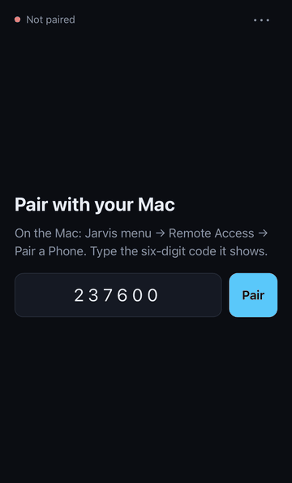
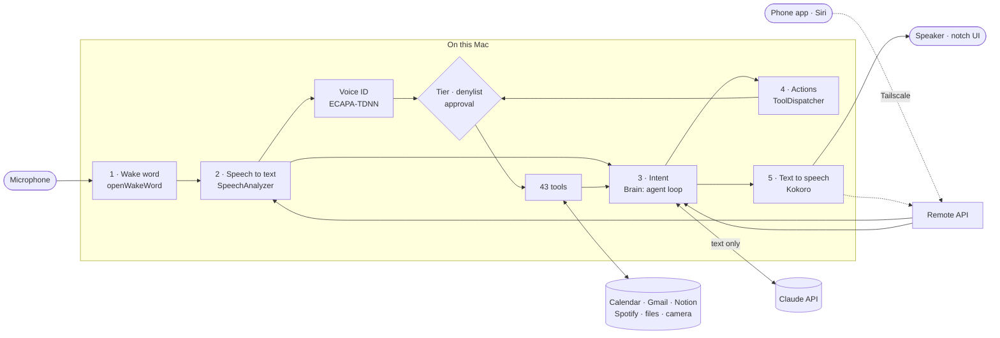

# Jarvis

A voice assistant that lives in the MacBook notch: speech stays on-device, Claude does the reasoning, and every action passes a permission system enforced in code.


<p align="center">
  
</p>

<p align="center"><sub>The phone app talking to Jarvis on the Mac over a private Tailscale network: pair with a code, ask, get the answer.</sub></p>

Say "Hey Jarvis", ask for something, and it answers out loud and gets it done: calendar, email, notes,
music, the camera, files, the web. It is a native macOS menu bar app written in Swift.

## Problem

An assistant that can run shell commands, read email and change system settings is only useful if you can
trust what it will not do. Instructions in a prompt are not a safety model: a model can be talked out of
them, and so can anything that reads untrusted email or web pages on your behalf.

## Approach

Keep audio on the Mac, send only text to the model, and put a dispatcher between the model and every
tool. The dispatcher, not the prompt, decides whether a call runs, needs a spoken or tapped approval, or
is refused outright.

### What it does

- **Hands-free.** On-device wake word, on-device speech recognition, a natural on-device voice (Kokoro).
  Follow-up questions without repeating the wake word.
- **Gets things done.** 43 tools behind one dispatcher: calendar and reminders, Gmail, Notion, Spotify and
  Apple Music, files, apps, the screen and the camera, web search. Multi-step requests chain tools.
- **Asks before anything risky.** Sending, deleting, shell commands and anything involving money need a
  spoken "yes" or a tap, in your voice. Keys, passwords, `~/.ssh` and anything on the denylist are refused
  outright, even if you ask.
- **Knows it is you.** Speaker verification (ECAPA-TDNN, on-device) gates approvals.
- **From your phone.** A mic-button web app, a hands-free call mode and a Siri shortcut, over your private
  Tailscale network. No public port, no account, no app store.
- **Local-first.** No audio leaves the Mac. A Privacy menu shows exactly what does (text to Claude), and
  logs are pruned on a schedule.
- **Stays up.** A launchd supervisor, a hang watchdog, retries, a daily spending cap, and a spoken reason
  when something fails.

### How it works

Every request passes through five stages. Each stage sits behind a small Swift protocol
([Pipeline/Stages.swift](Sources/JarvisCore/Pipeline/Stages.swift)), so it can be swapped or tested alone.



`ConversationController` wires the stages together and moves between five states (`idle`, `listening`,
`thinking`, `awaitingApproval`, `speaking`) through a single transition table. One request ID follows a
request through every stage into `trace.jsonl`, so latency is measured per stage.

| Stage | Folder | Runs |
|---|---|---|
| 1 Wake word | [`Wake/`](Sources/JarvisCore/Wake) | on-device (ONNX Runtime) |
| 2 Speech to text | [`STT/`](Sources/JarvisCore/STT) | on-device (Apple SpeechAnalyzer) |
| 3 Intent | [`Intent/`](Sources/JarvisCore/Intent) | Claude, streaming, with prompt caching; a local model offline |
| 4 Actions | [`Actions/`](Sources/JarvisCore/Actions) | on-device; three permission tiers checked before every call |
| 5 Text to speech | [`TTS/`](Sources/JarvisCore/TTS) | on-device (Kokoro, Apple); cloud voices optional |

More in [docs/architecture.md](docs/architecture.md).

## Results

- **43 tools** behind one dispatcher, each assigned to one of three permission tiers checked before every call.
- **362 tests**, grouped by pipeline stage (see Tests below). Every stage runs against fakes, and the
  whole pipeline runs end to end in a strict mode where an unexpected state change fails the test.
- **Prompt caching:** the tool schemas and personality block form a byte-stable prefix. Measured: the
  first turn writes about 9.9k tokens to the cache, and each following turn reads them and sends only
  about 700 fresh input tokens.
- **No audio leaves the Mac.** Wake word, speech recognition, speaker verification and the default voice
  all run on-device; the Privacy menu lists exactly what is sent (text to Claude).

Per-stage latency is traced for every request; `scripts/latency-report.py --last 50` prints the median,
90th percentile and worst case from your own usage.

## Quick start

Requires macOS 14 or newer on Apple Silicon and the Xcode command line tools.

```bash
git clone https://github.com/samarthpaliwal/Jarvis.git
cd Jarvis
scripts/fetch-models.sh          # wake-word models
scripts/make-dev-cert.sh         # a stable signing identity, so macOS remembers permissions
scripts/install-keyhelper.sh     # saved keys unlock with Touch ID
scripts/run.sh                   # build Jarvis.app and launch it
```

Then, from the Jarvis menu bar icon: **Set API Key…** (an [Anthropic API key](https://console.anthropic.com/)),
grant the microphone when asked, and say **"Hey Jarvis, what's left today?"**

Optional, each one command or one menu item:

| | |
|---|---|
| A natural on-device voice | `scripts/setup-kokoro.sh` |
| Voice ID | `scripts/setup-voiceid.sh`, then menu → Voice ID → Set Up |
| Keep it running, start at login | `scripts/install-agent.sh` |
| Gmail, Notion, Spotify | menu → Integrations |
| Your phone | [docs/remote-access.md](docs/remote-access.md) |

Full instructions: [docs/setup.md](docs/setup.md).

## Tests

```bash
scripts/test.sh            # everything, reported per pipeline stage
scripts/test.sh intent     # one stage: wake | stt | intent | actions | tts | pipeline | voiceid | remote | privacy | app
```

```
  ✓ 1 Wake word               9 tests  0 failed
  ✓ 2 Speech to text         13 tests  0 failed
  ✓ 3 Intent (Claude)        66 tests  0 failed
  ✓ 4 Actions (tools)        83 tests  0 failed
  ✓ 5 Text to speech         13 tests  0 failed
  ✓ Pipeline end to end      40 tests  0 failed
  ✓ Voice ID                 33 tests  0 failed
  ✓ Remote access            53 tests  0 failed
  ✓ Privacy and keys         18 tests  0 failed
  ✓ App and settings         33 tests  0 failed
```

Every stage is tested against fakes: no microphone, network, Keychain or real calendar is touched. The
whole pipeline also runs end to end on fakes in a strict mode where an unexpected state change fails the test.

## Safety, in one table

| Tier | Examples | What happens |
|---|---|---|
| Free | read the calendar, play music, look something up | runs |
| Approve | send an email, delete a file, run a shell command | says exactly what it will do, waits for your "yes" (in your voice) or a tap |
| Never | Keychain, saved passwords, `~/.ssh`, `.env`, `sudo`, anything in `denylist.json` | refused, even if you ask |

Content from emails, web pages and documents is treated as data, never as instructions. Every tool call
is logged. Details: [docs/privacy-and-security.md](docs/privacy-and-security.md).

## Documentation

| | |
|---|---|
| [Setup](docs/setup.md) | requirements, build, signing, permissions, API key, configuration |
| [Features](docs/features.md) | wake word, speech, calendar and email, modes, camera, memory |
| [Architecture](docs/architecture.md) | stages, state machine, tracing, latency, failure handling, supervisor |
| [Remote access](docs/remote-access.md) | Tailscale, the API, the phone app, call mode, Siri |
| [Privacy and security](docs/privacy-and-security.md) | what leaves the Mac, retention, tiers, Touch ID keys, Voice ID |
| [Known limitations](docs/known-limitations.md) | |
| [Changelog](CHANGELOG.md) | |

## Tech stack

Swift, SwiftUI and AppKit, ONNX Runtime (openWakeWord, ECAPA-TDNN), Apple SpeechAnalyzer, the Claude API
over streaming HTTPS, EventKit, Keychain and Touch ID, Kokoro TTS (Python), Tailscale for remote access.

## Project structure

```
Sources/
  Jarvis/                 entry point
  JarvisCore/
    Pipeline/             stage interfaces, state machine, ConversationController
    Wake/  STT/  Intent/  Actions/  TTS/        the five stages, one folder each
    VoiceID/  Vision/  Memory/  Skills/  Music/  what the stages draw on
    Integrations/  Context/  Proactive/          calendar, mail, notes; modes; scheduled nudges
    Remote/  Resources/WebApp/                   the remote API and the phone app it serves
    Privacy/  Config/  Logging/  Net/            data map and retention, settings, tracing, HTTP
    App/  NotchUI/                               wiring, menu bar, the notch and HUD
  JarvisKeyHelper/        Touch ID key helper (built once, never rebuilt)
  JarvisObjC/             Objective-C exception shim
Tests/JarvisCoreTests/    362 tests; scripts/test.sh groups them by stage
config/                   default profile, modes, allowed folders, denylist
scripts/                  build, run, test, setup and check scripts
voice/                    the Kokoro speech server (Python)
docs/                     the documentation above
.env.example              every setting that can be overridden, documented
```
